# WaxLog for Karoo

**Know when your chain needs fresh wax.** WaxLog is a Karoo extension for riders who wax their chains – and rotate
several of them: it counts the distance on every chain in your chain set while you ride, keeps track of the rotation,
and tells you in good time when the chain on your bike needs fresh wax and which one is ready to go on next.

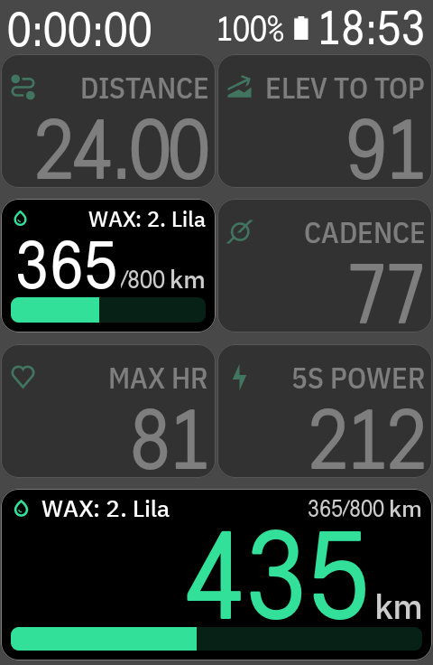

[Deutsch weiter unten ↓](#deutsch)

## Features

- **Chain rotation** – a chain set per bike: swap with one tap, mark a chain as waxed when it comes out of the pot,
  and see at a glance which chain is ready to go on and which needs waxing first.
- **Counts automatically** – every ride is credited to the chain that is on the bike, no typing.
- **Data field** – the active chain's distance and its wax limit at a glance, in three variants and any size. On
  large fields also this ride's distance and roughly how many rides the chain still lasts.
- **Alerts** – a popup and a beep when a chain is due soon (from 90 % of its limit, adjustable) and when it is
  due. Green, yellow and red in the field and in the app.
- **History** – every period a chain was on the bike, with distance and time; mistakes can be corrected.
- **Backups** – automatic backups on the Karoo, and a transfer over Wi-Fi to your phone or a new Karoo
  (just scan a QR code).
- **Updates by themselves** – new versions install automatically, never during a ride.
- km or miles and English or German, following your Karoo's settings.

## Screenshots

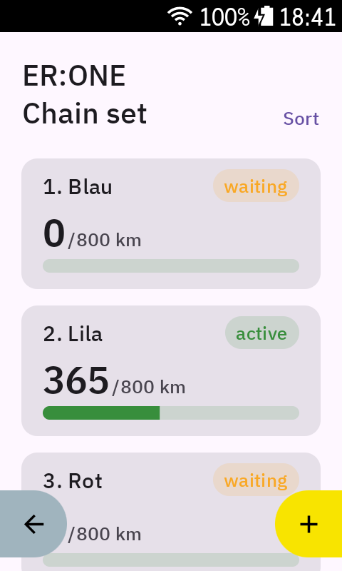
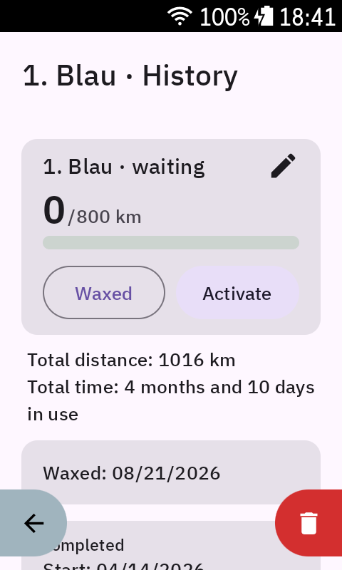
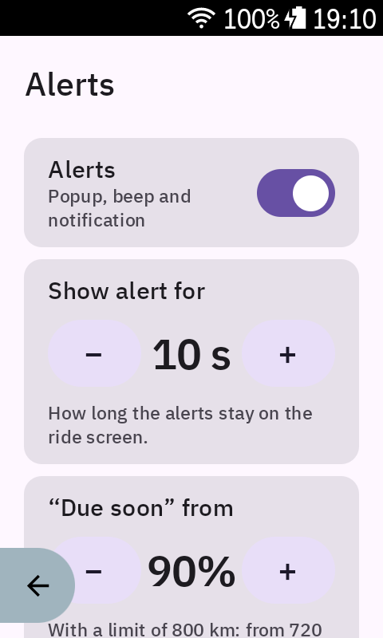
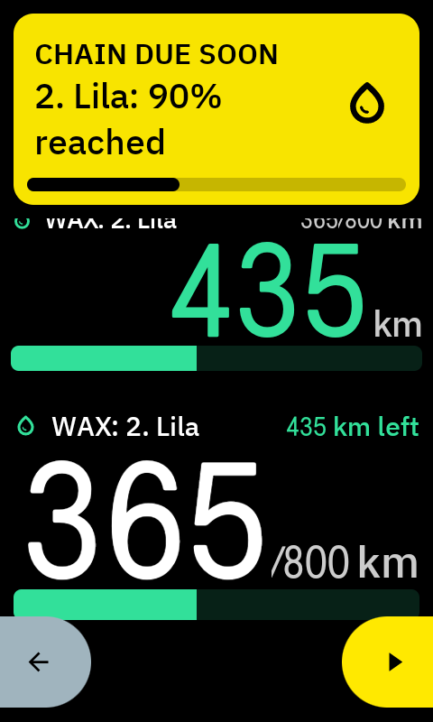
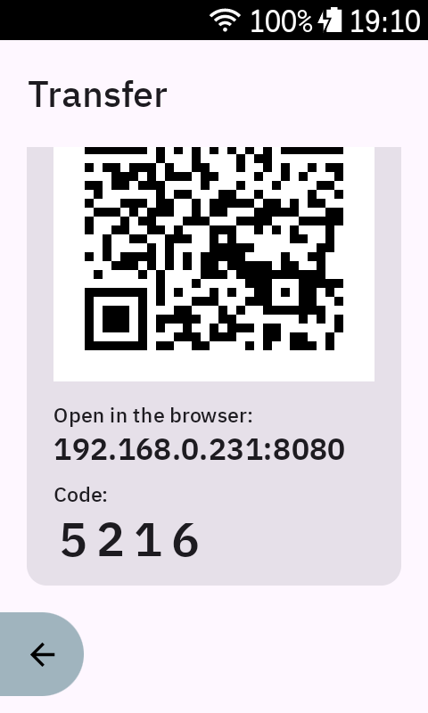

## Data field

Three variants to pick from when you add the field to a data page (*Remaining Top Right* differs from *WaxLog* on
narrow fields only):

| WaxLog | WaxLog Remaining | WaxLog Remaining Top Right |
|:---:|:---:|:---:|
| 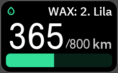 |  | 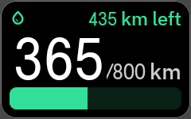 |
| distance and limit | distance left | distance left on top |

**Any size** – the field adapts to the room it gets. Large fields also show this ride's distance and roughly how many
rides the chain still lasts.

| Wide | Tall |
|:---:|:---:|
| 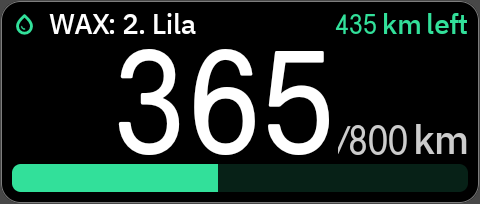 | 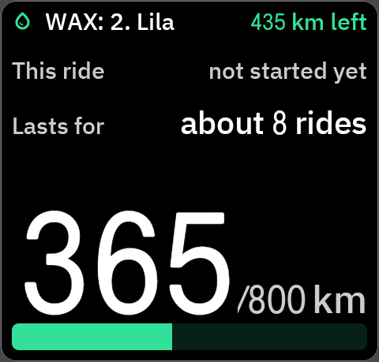 |

**Colors** – green, yellow from 10 % before *due soon*, red from *due soon* (90 % by default), and over the limit how
far over it is. On *WaxLog* the bar and the drop show the color, on *WaxLog Remaining* the big number too.

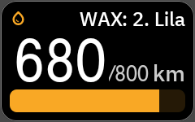
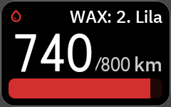
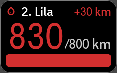

**Miles** – with your Karoo set to miles, WaxLog shows miles too (it stores km, so switching back and forth changes
nothing).

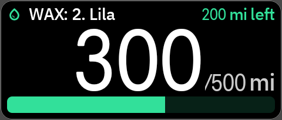

## Installation

Made for the **Karoo 3** (tested there).

1. On your phone, open the [latest release](https://github.com/Zalvato/Karoo-WaxLog/releases/latest).
2. Long-press **WaxLog-x.y.apk** and share the link with the **Hammerhead Companion app**. The Karoo downloads the APK
   itself, so it needs internet – Wi-Fi or your phone's hotspot.
3. The Karoo installs WaxLog. You'll find it under *Extensions*.

**Updates:** WaxLog updates itself – never during a ride. For that it needs your permission once: in WaxLog under
*Settings → Updates*, tap *Allow*, turn on *Allow from this source* and come back. If you'd rather decide yourself,
turn off *Update automatically* there and install new versions with *Check for updates* and *Install now*.

## Getting started

1. **Add your bike** – open WaxLog; your Karoo bikes are listed under *Add from Karoo*. Tap one to add it
   (or create a bike with *+*).
2. **Add your chains** – on the bike page tap *+*, give each chain a label (e.g. a color) and a wax limit, and
   *Activate* the one that is on the bike.
3. **Link your ride profile** – if the ride profile selected on your Karoo doesn't belong to a bike yet, WaxLog asks
   which bike it is when you open it. From then on, rides with that profile count for that bike. More profiles can be
   linked on the bike page. Rides from before the link aren't lost – they are added when you link.
   A profile belongs to one bike: if you ride several bikes, give each its own profile (e.g. a copy). *Why?* The
   Karoo doesn't tell extensions which bike a profile is set to – so the profile is the only way WaxLog can tell
   which bike you're riding.
4. **Add the data field** – in your Karoo's profile, edit a data page, add a field and pick *WaxLog* under the
   extensions.

When you've waxed a chain, tap *Waxed* in its history – the distance towards its next waxing starts again from 0,
while the chain's total distance stays recorded in its history. When you swap the chain on your bike, open the chain
you put on in WaxLog and tap *Activate* – from then on the distance counts for it, and the one you took off waits
until it's its turn again.

## Privacy

WaxLog keeps its data on your Karoo and sends it nowhere. It goes online only to check GitHub for updates. While
the *Transfer* page is open, it serves a page on your Wi-Fi, protected by a 4-digit code – it stops as soon as you
leave the page. During a ride it writes the active chain's distance into the ride's FIT file, so that value travels
wherever your Karoo uploads the ride.

## Questions and problems

Found a bug or have an idea? Please open an [issue](https://github.com/Zalvato/Karoo-WaxLog/issues).

Enjoying WaxLog? If you like, you can [buy me a coffee](https://buymeacoffee.com/zalvato).

WaxLog is free. Use it at your own risk – the distances and warnings are a help, but don't replace looking at your
chain yourself.

WaxLog is a private project and not affiliated with Hammerhead or SRAM. “Karoo” and “Hammerhead” are trademarks
of their respective owners.

---

## Deutsch

**Wissen, wann die Kette frisches Wachs braucht.** WaxLog ist eine Karoo-Extension für alle, die ihre Ketten
wachsen – und mehrere im Wechsel fahren: Sie zählt beim Fahren die Kilometer jeder Kette deines Ketten-Sets, behält
die Rotation im Blick und sagt dir rechtzeitig, wann die Kette auf dem Bike frisches Wachs braucht und welche als
Nächstes bereit ist.

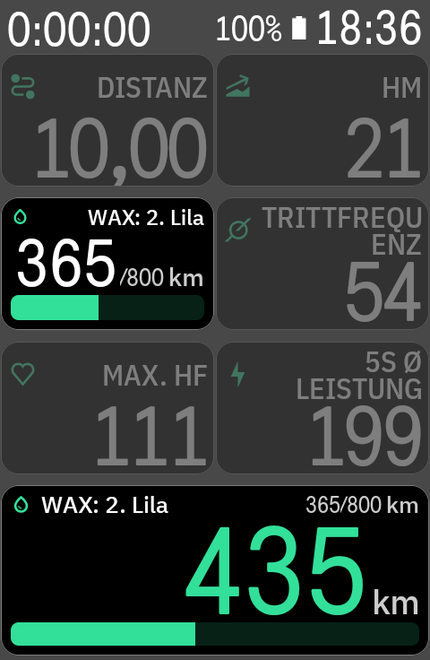

### Funktionen

- **Ketten-Rotation** – ein Ketten-Set pro Bike: Wechsel mit einem Tipp, „Gewachst“ markieren, wenn eine Kette aus
  dem Topf kommt, und auf einen Blick sehen, welche Kette bereit ist und welche erst wieder gewachst werden muss.
- **Zählt automatisch** – jede Fahrt wird der Kette gutgeschrieben, die gerade auf dem Bike ist, ohne Eintippen.
- **Datenfeld** – Kilometer der aktiven Kette und ihr Wachs-Limit auf einen Blick, in drei Varianten und jeder
  Größe. In großen Feldern zusätzlich die Strecke dieser Fahrt und wie viele Fahrten die Kette noch ungefähr hält.
- **Warnungen** – Popup und Piepton, wenn eine Kette bald fällig ist (ab 90 % des Limits, einstellbar) und wenn sie
  fällig ist. Grün, Gelb und Rot im Datenfeld und in der App.
- **Historie** – jeder Zeitraum, in dem eine Kette auf dem Bike war, mit Kilometern und Dauer; Fehler lassen sich
  korrigieren.
- **Sicherungen** – automatische Sicherungen auf dem Karoo und Übertragen per WLAN aufs Handy oder auf einen neuen
  Karoo (einfach QR-Code scannen).
- **Updates von selbst** – neue Versionen installieren sich automatisch, nie während einer Fahrt.
- km oder Meilen und Deutsch oder Englisch, je nach Einstellung deines Karoo.

### Screenshots

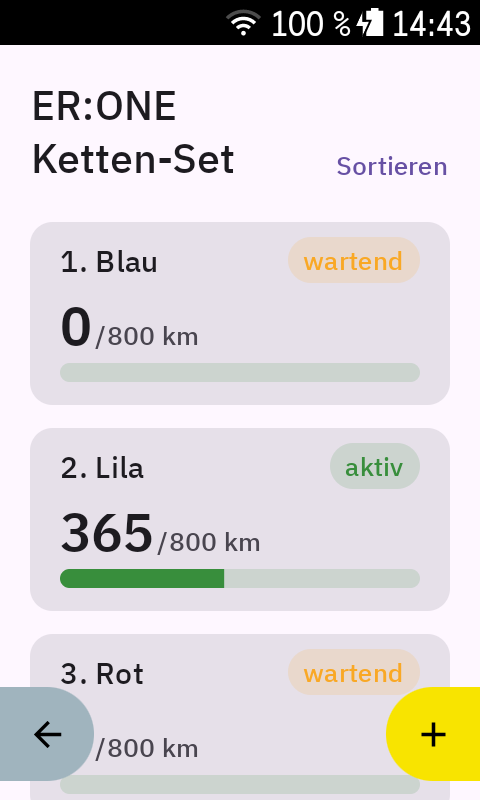
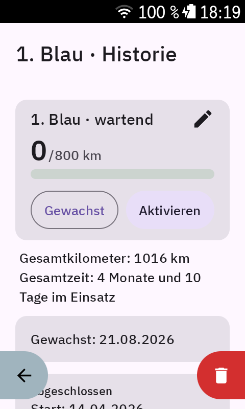
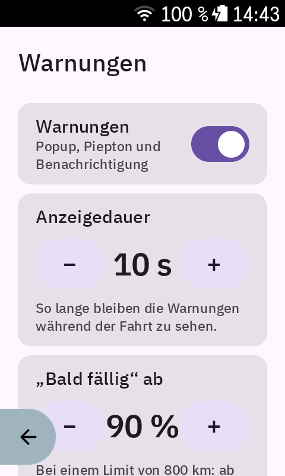
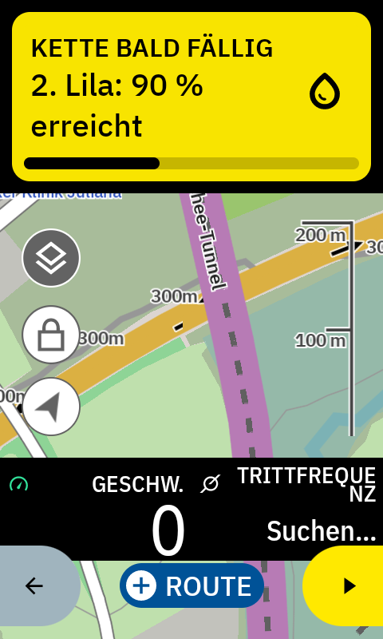
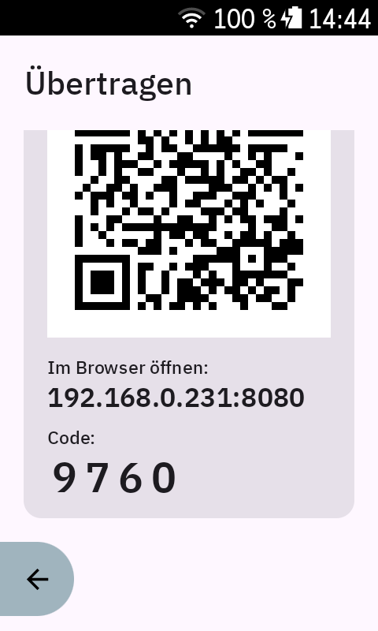

### Datenfeld

Drei Varianten zur Auswahl, wenn du das Feld auf eine Datenseite legst (*Rest oben rechts* unterscheidet sich von
*WaxLog* nur in schmalen Feldern):

| WaxLog | WaxLog Rest | WaxLog Rest oben rechts |
|:---:|:---:|:---:|
|  | 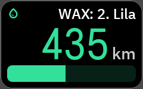 | 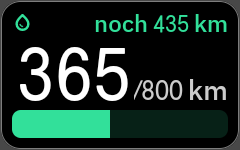 |
| Kilometer und Limit | Kilometer bis zum Limit | Rest oben rechts |

**Jede Größe** – das Feld passt sich dem Platz an. Große Felder zeigen zusätzlich die Strecke dieser Fahrt und wie
viele Fahrten die Kette noch ungefähr hält.

| Breit | Hoch |
|:---:|:---:|
| 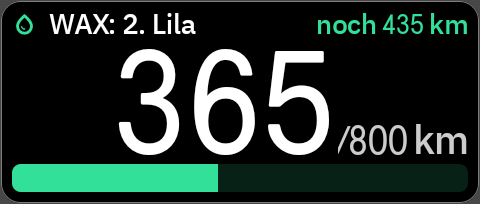 | 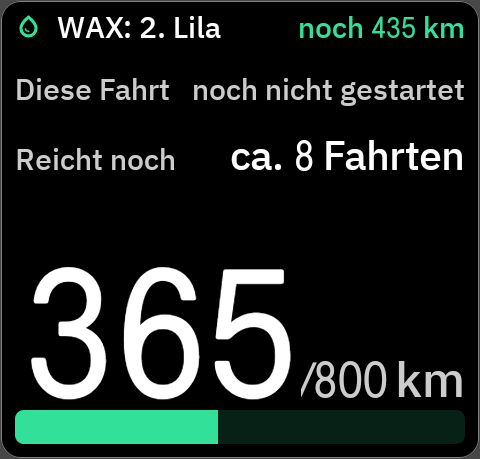 |

**Farben** – Grün, Gelb ab 10 % vor *bald fällig*, Rot ab *bald fällig* (standardmäßig 90 %) und über dem Limit, wie
weit es darüber ist. Bei *WaxLog* zeigen Balken und Tropfen die Farbe, bei *WaxLog Rest* auch die große Zahl.

### Installation

Für den **Karoo 3** (dort getestet).

1. Öffne auf dem Handy die [neueste Version](https://github.com/Zalvato/Karoo-WaxLog/releases/latest).
2. Drücke lange auf **WaxLog-x.y.apk** und teile den Link mit der **Hammerhead-Companion-App**. Der Karoo lädt die APK
   selbst herunter und braucht dafür Internet – WLAN oder den Hotspot deines Handys.
3. Der Karoo installiert WaxLog. Du findest es danach unter *Erweiterungen*.

**Updates:** WaxLog aktualisiert sich von selbst – nie während einer Fahrt. Dafür braucht es einmalig deine
Erlaubnis: in WaxLog unter *Einstellungen → Updates* auf *Erlauben* tippen, *Aus dieser Quelle zulassen* einschalten
und zurückkommen. Möchtest du lieber selbst entscheiden, schalte dort *Automatisch aktualisieren* aus und installiere
neue Versionen mit *Nach Updates suchen* und *Jetzt installieren*.

### Erste Schritte

1. **Bike anlegen** – öffne WaxLog; deine Karoo-Bikes stehen unter *Von Karoo übernehmen*. Tippe eins an, um es zu
   übernehmen (oder lege mit *+* ein Bike an).
2. **Ketten anlegen** – auf der Bike-Seite *+* tippen, jeder Kette einen Namen (z. B. eine Farbe) und ein Wachs-Limit
   geben und die Kette *Aktivieren*, die auf dem Bike ist.
3. **Fahrprofil verknüpfen** – gehört das im Karoo ausgewählte Fahrprofil noch zu keinem Bike, fragt WaxLog beim
   Öffnen, welches Bike es ist. Ab dann zählen Fahrten mit diesem Profil für dieses Bike. Weitere Profile verknüpfst
   du auf der Bike-Seite. Fahrten von vor dem Verknüpfen gehen nicht verloren – sie werden beim Verknüpfen nachgetragen.
   Ein Profil gehört zu einem Bike: Fährst du mehrere Räder, lege pro Rad ein eigenes Profil an (z. B. als Kopie).
   *Warum?* Der Karoo verrät Extensions nicht, welches Fahrrad in einem Profil eingestellt ist – das Profil ist deshalb
   der einzige Weg, an dem WaxLog erkennen kann, welches Bike du fährst.
4. **Datenfeld hinzufügen** – im Profil deines Karoo eine Datenseite bearbeiten, ein Feld hinzufügen und unter den
   Erweiterungen *WaxLog* wählen.

Hast du eine Kette gewachst, tippe in ihrer Historie auf *Gewachst* – die Kilometer bis zur nächsten Wachsung beginnen
wieder bei 0, die gesamte Laufleistung der Kette bleibt in der Historie erhalten. Wechselst du am Bike die Kette, öffne
in WaxLog die Kette, die du aufziehst, und tippe auf *Aktivieren* – ab dann zählen die Kilometer für sie, und die
abgenommene Kette wartet, bis sie wieder dran ist.

### Datenschutz

WaxLog speichert seine Daten auf deinem Karoo und schickt sie nirgendwohin. Online geht es nur, um auf GitHub nach
Updates zu suchen. Solange die Seite *Übertragen* offen ist, stellt es im WLAN eine Seite bereit, geschützt durch einen
vierstelligen Code – sobald du die Seite verlässt, ist sie weg. Während einer Fahrt schreibt es den Kilometerstand der
aktiven Kette in die FIT-Datei der Fahrt; dieser Wert geht also mit, wohin dein Karoo die Fahrt hochlädt.

### Fragen und Probleme

Einen Fehler gefunden oder eine Idee? Gern als [Issue](https://github.com/Zalvato/Karoo-WaxLog/issues) melden –
auch auf Deutsch.

Gefällt dir WaxLog? Wenn du magst, kannst du mir [einen Kaffee ausgeben](https://buymeacoffee.com/zalvato).

WaxLog ist kostenlos. Die Nutzung erfolgt ohne Gewähr – die Kilometer und Warnungen sind eine Hilfe, ersetzen aber
nicht den eigenen Blick auf die Kette.

WaxLog ist ein privates Projekt und steht in keiner Verbindung zu Hammerhead oder SRAM. „Karoo“ und „Hammerhead“
sind Marken ihrer jeweiligen Inhaber.
